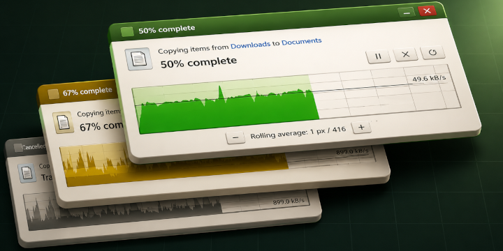
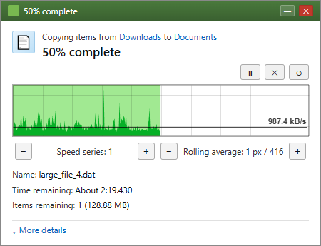
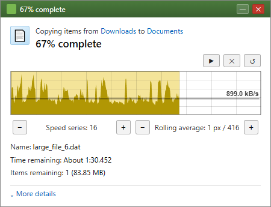
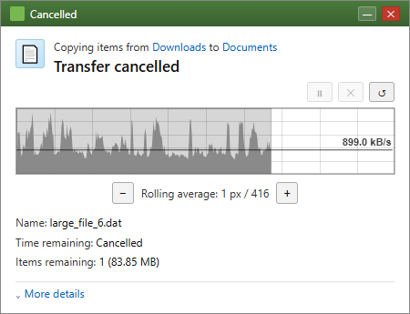

# Transfer Speed Graph



[Transfer Speed Graph homepage](https://speed-transfer.arijs.org/) / [NPM Package](https://npmjs.com/package/@arijs/transfer-speed-graph) 

A lightweight, modular transfer-speed graph inspired by the Windows 8 file transfer dialog, with support for:

- Real transfer integration (download/upload)
- Deterministic and random fake transfer simulation
- Pause/cancel/finish states
- Highly configurable graph smoothing and dynamic Y-scale behavior

### Real Example

[Live homepage](https://speed-transfer.arijs.org/)



## Quick Usage

### Install

```bash
npm install @arijs/transfer-speed-graph
```

Then use the object:

```js
import { TransferGraph } from '@arijs/transfer-speed-graph'

const graph = new TransferGraph()
```

CommonJS (`require`) works too:

```js
const { TransferGraph } = require('@arijs/transfer-speed-graph')
```

### CDN

If you prefer not to use a bundler, you can use either ES module imports or the UMD bundle.

ES module import via jsDelivr:

```js
import { TransferGraph } from 'https://cdn.jsdelivr.net/npm/@arijs/transfer-speed-graph@latest/+esm'

const graph = new TransferGraph()
```

ES module import via unpkg:

```js
import { TransferGraph } from 'https://unpkg.com/@arijs/transfer-speed-graph@latest?module'

const graph = new TransferGraph()
```

UMD script via jsDelivr:

```html
<script src="https://cdn.jsdelivr.net/npm/@arijs/transfer-speed-graph@latest/dist/arijs-transfer-speed-graph.umd.js"></script>
```

UMD script via unpkg:

```html
<script src="https://unpkg.com/@arijs/transfer-speed-graph@latest/dist/arijs-transfer-speed-graph.umd.js"></script>
```

### Package files

| File | Format | Used by |
| --- | --- | --- |
| `dist/arijs-transfer-speed-graph.js` | ES module | `import` (Node, bundlers), jsDelivr `/+esm`, unpkg `?module` |
| `dist/arijs-transfer-speed-graph.umd.cjs` | UMD | `require()` in Node. It is `.cjs` because the package is `"type": "module"`, so Node would read a `.js` file as ESM |
| `dist/arijs-transfer-speed-graph.umd.js` | UMD, same content as `.umd.cjs` | `<script>` tags and the CDN links above. Defines the global `TransferSpeedGraph` |

`package.json` maps `import` to the ES module and `require` to the `.umd.cjs` bundle. The bundles are built for Chrome 109, Edge 109, Firefox 115 and Safari 16, so they still run on Windows 7.

### HTML Script Tag

After loading one of the CDN scripts above, you can initialize the graph with a minimal HTML snippet:

```html
<canvas id="graph" width="416" height="72"></canvas>
<script>
  const graph = new TransferSpeedGraph.TransferGraph()
  const canvasCtx = document.getElementById('graph').getContext('2d')

  graph.setRendererOptions({
    canvasCtx,
    canvasWidth: 416,
    canvasHeight: 72,
  })

  graph.startTransfer({ totalSize: 12 * 1024 * 1024 })
</script>
```

On high-density screens the library sizes the canvas for you, so the graph stays sharp; see [`pixelRatio`](#high-density-screens-pixelratio).

### Download Example

```js
import { TransferGraph } from '@arijs/transfer-speed-graph'

const controller = new TransferGraph()
controller.setOnFrame((view) => {
  // update your UI with view.progressInt, view.speedBps, etc.
})

const downloadUrl = 'https://httpbin.org/bytes/12582912?seed=2026'
const fallbackTotalSize = 12 * 1024 * 1024

controller.setRendererOptions({
  canvasCtx,
  canvasWidth: 416,
  canvasHeight: 72,
})

fetch(downloadUrl).then(async (res) => {
  if (!res.ok || !res.body) throw new Error('Download failed: ' + res.status)

  const totalHeader = parseInt(res.headers.get('content-length') || '0', 10)
  const totalSize = Number.isFinite(totalHeader) && totalHeader > 0
    ? totalHeader
    : fallbackTotalSize

  const reader = res.body.getReader()
  let transferredBytes = 0

  controller.startTransfer({ totalSize })

  while (true) {
    const chunk = await reader.read()
    if (chunk.done) break
    transferredBytes += chunk.value.byteLength
    controller.pushProgress({ transferredBytes, totalSize })
  }

  controller.finishTransfer({ transferredBytes, totalSize })
}).catch((err) => {
  console.warn(err)
  controller.cancel()
})
```

Source example: [real/download-example.js](real/download-example.js)

### Upload Example

```js
import { TransferGraph } from '@arijs/transfer-speed-graph'

const controller = new TransferGraph()
const uploadUrl = 'https://httpbin.org/post'
const uploadSize = 10 * 1024 * 1024

const xhr = new XMLHttpRequest()
const payload = new Blob([new Uint8Array(uploadSize)])

controller.setRendererOptions({
  canvasCtx,
  canvasWidth: 416,
  canvasHeight: 72,
})
controller.startTransfer({ totalSize: uploadSize })

xhr.upload.addEventListener('progress', (ev) => {
  if (!ev.lengthComputable) return
  controller.pushProgress({
    transferredBytes: ev.loaded,
    totalSize: ev.total,
  })
})

xhr.addEventListener('load', () => {
  controller.finishTransfer({
    transferredBytes: uploadSize,
    totalSize: uploadSize,
  })
})

xhr.addEventListener('error', () => {
  console.warn('upload failed')
  controller.cancel()
})

xhr.addEventListener('abort', () => {
  controller.cancel()
})

xhr.open('POST', uploadUrl)
xhr.send(payload)
```

Source example: [real/upload-example.js](real/upload-example.js)

## State Showcase

Paused state:



Cancelled state:



## Why This Library Is Strong

### Source Files

The published package is split by concern:

- Graph core:
  - [core/main.js](core/main.js)
    public `TransferGraph` facade that coordinates model, renderer, and runtime APIs.
  - [core/model.js](core/model.js)
    transfer state machine plus series, timing, and control state management.
  - [core/renderer.js](core/renderer.js)
    renderer configuration layer that resolves options and delegates frame drawing.
  - [core/frame.js](core/frame.js)
    canvas frame rendering, graph geometry, and draw-hook execution.
  - [core/speed-series.js](core/speed-series.js)
    series utilities for averaging, speed calculations, and coordinate transforms.
- Fake transfer subsystem:
  - [fake/progress-source.js](fake/progress-source.js)
    controller bridge that drives fake progress updates into the graph.
  - [fake/simulation.js](fake/simulation.js)
    deterministic/random simulation engine for timing and size progression.
  - [fake/series.js](fake/series.js)
    fake-series helpers and presets used by the simulator.
- Real transfer examples:
  - [real/download-example.js](real/download-example.js)
    streaming download example wired to the graph controller.
  - [real/upload-example.js](real/upload-example.js)
    upload progress example wired to the graph controller.

That separation keeps rendering, state management, fake generation, and transport examples independent and easy to evolve.

### High Configurability

Graph behavior can be tuned at runtime with controls such as:

- `pixelAverageWindow`
- `maxSpeedDecay`
- `maxSpeedHeadroom`
- `ignoreTrailingSpeedSample`
- `minSampleIntervalMs`

Fake simulation is configurable through `simulationOptions`, including:

- `minFrame`, `maxFrame`
- `minFrameRepeat`, `maxFrameRepeat`
- `minSizeInc`, `maxSizeInc`
- `deterministicSeed`

This allows both realistic noisy profiles and stable deterministic test profiles.

## Options

`new TransferGraph(options)` accepts both renderer and model options (their keys do not overlap). You can change them later with `setRendererOptions(options)` and `setModelOptions(options)`; keys you leave out keep their current value.

### Renderer options (`setRendererOptions`)

- `canvasCtx`: the `CanvasRenderingContext2D` to draw on.
- `canvasWidth`, `canvasHeight`: graph size in CSS pixels (default `416` × `72`).
- `pixelRatio`: device pixels per CSS pixel, for sharp drawing on high-density screens. See below.
- `formatSpeed(bytesPerSecond)`: formats the speed label.
- `pausedRenderOptions`, `cancelledRenderOptions`: colours used in those states.
- Draw hooks: see [Canvas Drawing Hooks](#canvas-drawing-hooks).

#### High-density screens (`pixelRatio`)

When `devicePixelRatio` is above 1 (high-DPI monitors, phones, Windows display scaling at 125 % or 150 %, browser zoom), a canvas whose pixel size equals its CSS size gets stretched and looks blurry. The library handles this for you:

- `canvasWidth` and `canvasHeight` stay in CSS pixels.
- Before each frame it sets `canvas.width = round(canvasWidth × pixelRatio)` and `canvas.height` the same way (only when the value changes, because assigning them clears the canvas). It also fixes the CSS size with `canvas.style.width` / `canvas.style.height` when the canvas has `style`, and draws with `setTransform(pixelRatio, 0, 0, pixelRatio, 0, 0)`. The context transform is restored after the frame.

Values:

- Not set, `'auto'` or `null` (default): for a `<canvas>` element, uses `globalThis.devicePixelRatio || 1`, read again at every frame, so it follows zoom changes and a window moved to another monitor. Outside the DOM (node-canvas, `OffscreenCanvas`) the ratio is `1` and the canvas is left untouched, as in 0.1.3.
- A number greater than 0: always applied, on any canvas.
- `false` (or `0`): the library never touches the canvas size, CSS size or transform.

Scale the canvas **either** with this option **or** by hand, not both. If you already scale by hand (bigger `canvas.width` plus `ctx.scale(dpr, dpr)`), pass `pixelRatio: false` or remove your code. If you forget, the scale is still not doubled: in automatic mode the library leaves the canvas alone when the context already has a transform, and an explicit `pixelRatio` uses `setTransform`, which replaces the transform instead of multiplying it. One case cannot be detected: `canvasWidth` / `canvasHeight` given in device pixels. Always pass CSS pixels.

```js
graph.setRendererOptions({ canvasCtx, canvasWidth: 416, canvasHeight: 72 }) // automatic
graph.setRendererOptions({ pixelRatio: 2 })     // fixed ratio
graph.setRendererOptions({ pixelRatio: false }) // I scale the canvas myself
```

### Model options (`setModelOptions`)

- `now`: function that returns the current time in milliseconds (default `Date.now`). Every clock read goes through it: `startTransfer`, `pushProgress`, `finishTransfer`, `pause`, `resume`, and the elapsed and remaining times in the frame view. Use it for deterministic tests:

  ```js
  let t = 0
  const graph = new TransferGraph({ canvasCtx, now: () => t })
  graph.startTransfer({ totalSize: 1000 })
  t += 500
  graph.pushProgress({ transferredBytes: 250 }) // 250 bytes after 500 ms
  graph.setModelOptions({ now: () => performance.now() }) // can be swapped at any time
  ```

  It replaces assigning `graph.model.now` by hand (which still works). Explicit `nowMs` / `elapsedMs` arguments still take precedence over the clock.
- `minSampleIntervalMs` (default `50`): progress updates that arrive less than this many milliseconds after the previous point do not become speed samples, because a few bytes in 1 ms read as a huge speed and flatten the rest of the curve. They still update the displayed progress, and the next update far enough apart replaces them. The final update (`finishTransfer`, or reaching `totalSize`) is always kept. `0` keeps every update (the 0.1.3 behaviour).
- `pixelAverageWindow`, `maxSpeedDecay`, `maxSpeedHeadroom`, `ignoreTrailingSpeedSample`: see [High Configurability](#high-configurability).
- `totalSize`: total size restored by `reset()`.

## Practical Runtime API

`TransferGraph` gives a straightforward app-facing API:

- `startTransfer`

  Start a new transfer and reset the runtime state.

  Signature:

  ```js
  startTransfer(config)
  ```

  - `config.totalSize`: required positive total size for the transfer.
  - `config.transferredBytes`: optional bytes already transferred, when the screen opens in the middle of a transfer. Progress and graph start from there.
  - `config.nowMs`: optional timestamp of when the transfer really started, on the same clock as the `now` option (`Date.now()` by default). Defaults to now.

  Example:

  ```js
  const graph = new TransferGraph()
  graph.startTransfer({ totalSize: 12 * 1024 * 1024 })
  ```

  Opening the graph in the middle of a transfer: pass `transferredBytes` and `nowMs`. The first segment of the curve is then the average speed since `nowMs`. Without them, all the bytes already done would arrive with the first `pushProgress`, a few milliseconds after `startTransfer`, and show up as a speed spike that takes over the Y scale and flattens the rest of the curve.

  ```js
  graph.startTransfer({
    totalSize: job.totalBytes,
    transferredBytes: job.doneBytes, // e.g. 40 % already done
    nowMs: job.startedAt,            // Date.now() value of when the transfer started
  })
  ```

  If you pass `transferredBytes` without `nowMs`, the time already spent is unknown. The part already done is drawn at the speed measured between the first updates, and the remaining-time estimate uses that speed; `view.elapsedMs` counts from `startTransfer`.

- `pushProgress`

  Append a new progress update to the active transfer.

  Signature:

  ```js
  pushProgress(update)
  ```

  - `update.transferredBytes`: current transferred byte count.
  - `update.totalSize`: optional total size override.
  - `update.elapsedMs`: optional elapsed time override.
  - `update.nowMs`: optional timestamp used to resolve elapsed time.

  Example:

  ```js
  const graph = new TransferGraph()
  graph.pushProgress({ transferredBytes: 4 * 1024 * 1024 })
  ```

- `finishTransfer`

  Mark the transfer as finished and capture the final point.

  Signature:

  ```js
  finishTransfer(update)
  ```

  - `update.transferredBytes`: final transferred byte count.
  - `update.totalSize`: optional total size override.
  - `update.elapsedMs`: optional elapsed time override.
  - `update.nowMs`: optional timestamp used to resolve elapsed time.

  Example:

  ```js
  const graph = new TransferGraph()
  graph.finishTransfer({ transferredBytes: 12 * 1024 * 1024 })
  ```

- `cancel`

  Cancel the active transfer and freeze it in a finished state.

  Signature:

  ```js
  cancel()
  ```

  Example:

  ```js
  const graph = new TransferGraph()
  graph.cancel()
  ```

- `reset`

  Reset the model back to its initial state.

  Signature:

  ```js
  reset()
  ```

  Example:

  ```js
  const graph = new TransferGraph()
  graph.reset()
  ```

- `pause`

  Pause elapsed-time tracking without clearing transfer progress.

  Signature:

  ```js
  pause(nowMs)
  ```

  - `nowMs`: optional timestamp used to freeze elapsed-time calculations.

  Example:

  ```js
  const graph = new TransferGraph()
  graph.pause()
  ```

- `resume`

  Resume elapsed-time tracking after a pause.

  Signature:

  ```js
  resume(nowMs)
  ```

  - `nowMs`: optional timestamp used to resume elapsed-time calculations.

  Example:

  ```js
  const graph = new TransferGraph()
  graph.resume()
  ```

- `toggleFinishedPauseVisual`

  Toggle the paused visual state that is shown after a transfer finishes.

  Signature:

  ```js
  toggleFinishedPauseVisual()
  ```

  Example:

  ```js
  const graph = new TransferGraph()
  graph.toggleFinishedPauseVisual()
  ```

- `refreshGraphScale`

  Force the renderer to recalculate the speed scale on the next frame.

  Signature:

  ```js
  refreshGraphScale()
  ```

  Example:

  ```js
  const graph = new TransferGraph()
  graph.refreshGraphScale()
  ```

- `setPixelAverageWindow`

  Change the rolling average window used by the renderer.

  Signature:

  ```js
  setPixelAverageWindow(nextWindow)
  ```

  - `nextWindow`: smoothing window size in rendered points.

  Example:

  ```js
  const graph = new TransferGraph()
  graph.setPixelAverageWindow(16)
  ```

- `setMaxSpeedDecay`

  Change the decay factor used for the dynamic speed scale.

  Signature:

  ```js
  setMaxSpeedDecay(nextValue)
  ```

  - `nextValue`: new decay value, typically between `0.5` and `0.999`.

  Example:

  ```js
  const graph = new TransferGraph()
  graph.setMaxSpeedDecay(0.95)
  ```

- `setMaxSpeedHeadroom`

  Change the headroom factor used for the dynamic speed scale.

  Signature:

  ```js
  setMaxSpeedHeadroom(nextValue)
  ```

  - `nextValue`: new headroom value, typically between `1` and `2`.

  Example:

  ```js
  const graph = new TransferGraph()
  graph.setMaxSpeedHeadroom(1.08)
  ```

- `setOnFrame`

  Register a callback that receives the computed frame view model.

  Signature:

  ```js
  setOnFrame(onFrame)
  ```

  - `onFrame(view)`: receives the computed frame view model.

  Example:

  ```js
  const graph = new TransferGraph()
  graph.setOnFrame((view) => {
  console.log(view.progressInt)
  })
  ```

- `setOnControls`

  Register a callback that receives the current controls state.

  Signature:

  ```js
  setOnControls(onControls)
  ```

  - `onControls(view)`: receives the current controls state.

  Example:

  ```js
  const graph = new TransferGraph()
  graph.setOnControls((controls) => {
  console.log(controls.pixelAverageWindow)
  })
  ```

- `setOnStateChange`

  Register a callback that receives the raw state snapshot.

  Signature:

  ```js
  setOnStateChange(onStateChange)
  ```

  - `onStateChange(state)`: receives the raw state snapshot.

  Example:

  ```js
  const graph = new TransferGraph()
  graph.setOnStateChange((state) => {
  console.log(state.started, state.finished)
  })
  ```

## Canvas Drawing Hooks

The renderer also exposes optional hooks for custom canvas drawing. If you do not provide any of them, the default implementation keeps the current visual behavior.

Pass these through `new TransferGraph({ ... })` or `controller.setRendererOptions({ ... })`:

### Common argument properties

Every draw hook receives these shared properties:

- `canvasCtx`: the active 2D canvas context for the current frame.
- `canvasWidth`: the canvas width in pixels.
- `canvasHeight`: the canvas height in pixels.

- `drawProgressBar`

  Signature:

  ```js
  drawProgressBar({ canvasCtx, canvasWidth, canvasHeight, lastX, backgroundValue, createDefaultPath })
  ```

  - `lastX`: the resolved filled width of the progress bar in canvas coordinates.
  - `backgroundValue`: the value used to compute the background fill width.
  - `createDefaultPath()`: builds the current progress-bar path with `beginPath()` + `rect()`.

  Default behavior: the renderer calls `createDefaultPath()`, then `fill()` and `stroke()`.

  ```js
  const graph = new TransferGraph({
  drawProgressBar({ canvasCtx, createDefaultPath }) {
    createDefaultPath()
    canvasCtx.fill()
    canvasCtx.stroke()
  },
  })
  ```

- `drawGrid`

  Signature:

  ```js
  drawGrid({ canvasCtx, canvasWidth, canvasHeight, gridCols, gridRows, createDefaultPath })
  ```

  - `gridCols`: number of vertical grid divisions.
  - `gridRows`: number of horizontal grid divisions.
  - `createDefaultPath()`: builds the current grid paths for both directions.

  Default behavior: the renderer calls `createDefaultPath()`, then `stroke()`.

  ```js
  const graph = new TransferGraph({
  drawGrid({ canvasCtx, createDefaultPath }) {
    createDefaultPath()
    canvasCtx.stroke()
  },
  })
  ```

- `drawSpeedOverlay`

  Signature:

  ```js
  drawSpeedOverlay({ canvasCtx, canvasWidth, canvasHeight, lastX, endX, avgWithSpeeds, renderPointCount, pixelsPerValue, maxAvgSpeed, createDefaultPath })
  ```

  - `lastX`: the resolved filled width of the progress area.
  - `endX`: the right edge where the overlay path should continue until the filled progress ends.
  - `avgWithSpeeds`: the calculated speed points used to draw the overlay.
  - `renderPointCount`: number of points used when rendering the visible speed curve.
  - `pixelsPerValue`: the conversion factor from value units to canvas X pixels.
  - `maxAvgSpeed`: the resolved speed scale used to normalize the overlay height.
  - `createDefaultPath()`: builds the current speed-area path and returns the resolved point position via the internal path logic.

  Default behavior: the renderer calls `createDefaultPath()`, then `fill()`.

  ```js
  const graph = new TransferGraph({
  drawSpeedOverlay({ canvasCtx, createDefaultPath }) {
    createDefaultPath()
    canvasCtx.fill()
  },
  })
  ```

- `drawSpeedLineLabel`

  Signature:

  ```js
  drawSpeedLineLabel({ canvasCtx, canvasWidth, canvasHeight, guideY, textX, labelBottomY, labelTopY, labelLeftX, labelWidth, labelPaddingX, labelPaddingY, speedLabel, speedLabelColor, speedLabelBackgroundColor, speedGuideColor, createDefaultLinePath, createDefaultLabelBackgroundPath, fillDefaultLabelText })
  ```

  - `guideY`: the Y position of the horizontal guide line.
  - `textX`: the right-aligned X position used for the label text.
  - `labelBottomY`: the baseline Y position for the label text.
  - `labelTopY`: the top Y position of the background box.
  - `labelLeftX`: the left X position of the background box.
  - `labelWidth`: measured width of the label text.
  - `labelPaddingX`: horizontal padding used by the default label box.
  - `labelPaddingY`: vertical padding used by the default label box.
  - `speedLabel`: the formatted label string.
  - `speedLabelColor`: the current text color.
  - `speedLabelBackgroundColor`: the current background fill color.
  - `speedGuideColor`: the current guide-line stroke color.
  - `createDefaultLinePath()`: builds the current guide-line path.
  - `createDefaultLabelBackgroundPath()`: builds the current label background path with `beginPath()` + `rect()`.
  - `fillDefaultLabelText(options)`: draws the current text using `fillText()`. You can override the fill style or text alignment through `options`.

  Default behavior: the renderer calls the default line path, strokes it, calls the default background path, fills it, and then calls `fillDefaultLabelText()`.

  ```js
  const graph = new TransferGraph({
  drawSpeedLineLabel({
    canvasCtx,
    createDefaultLinePath,
    createDefaultLabelBackgroundPath,
    fillDefaultLabelText,
  }) {
    createDefaultLinePath()
    canvasCtx.stroke()
    createDefaultLabelBackgroundPath()
    canvasCtx.fill()
    fillDefaultLabelText()
  },
  })
  ```

- `drawBorder`

  Signature:

  ```js
  drawBorder({ canvasCtx, canvasWidth, canvasHeight, borderColor, createDefaultPath })
  ```

  - `borderColor`: the current border stroke color.
  - `createDefaultPath()`: builds the current canvas border path with `beginPath()` + `rect()`.

  Default behavior: the renderer calls `createDefaultPath()`, then `stroke()`.

  ```js
  const graph = new TransferGraph({
  drawBorder({ canvasCtx, createDefaultPath }) {
    createDefaultPath()
    canvasCtx.stroke()
  },
  })
  ```


## Development

Install dependencies:

```bash
npm install
```

Build the bundles in `core/dist`:

```bash
npm run build
```

Run tests / snapshot checks (`simpler-test.js` regenerates the snapshots, `core-test.js` checks the `TransferGraph` API):

```bash
npm test
```

Check the npm package (packs `core/`, installs the tarball in a temporary folder, then loads it with `require` and `import`; run it after the build):

```bash
npm run test:package
```

Open the demo UI by loading [index.html](index.html) in a browser.

### Releasing

Publishing to npm is done by [.github/workflows/publish.yml](.github/workflows/publish.yml) with npm Trusted Publishing (no npm token in GitHub):

1. Bump `version` in `core/package.json` and commit it to `master`.
2. Tag that commit with the same version and push the tag:

   ```bash
   git tag v0.1.4 && git push origin v0.1.4
   ```

The workflow checks that the tag matches `core/package.json` and that the version is not published yet, runs `npm ci`, `npm run build`, `npm test` and `npm run test:package`, then runs `npm publish` from `core/` with a provenance attestation. Versions with a pre-release suffix (`0.2.0-beta.1`) go to the `next` dist-tag, the others to `latest`.

One-time setup on npmjs.com: in the package settings of `@arijs/transfer-speed-graph`, add a trusted publisher of type GitHub Actions with repository `rhengles/transfer-speed-graph` and workflow `publish.yml`.

## License

[MIT](LICENSE) © 2026 Rafael Hengles
